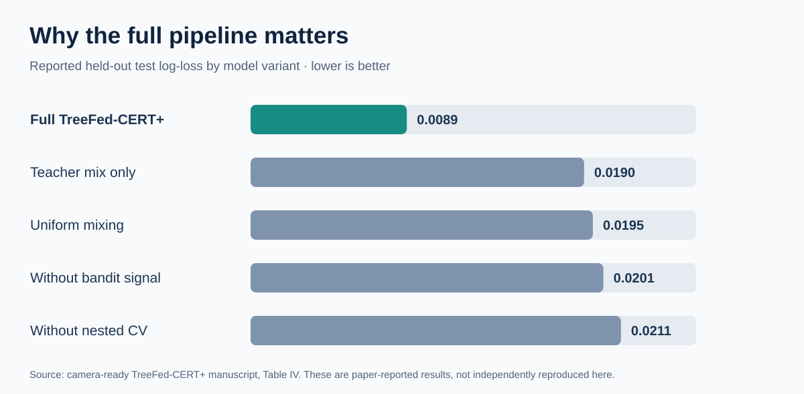

# TreeFed-CERT+ — Explainable Federated Intrusion Detection

**Research code and presentation materials for an IEEE WCCI 2026 / FUZZ-IEEE research project.**

**Paper:** *Empirical Bernstein Certified Bandit-KL Mixing with Tree Stacking for Explainable Federated Intrusion Detection*  
**First author:** Md. Zubayer Ahmad Shibly  
**Research area:** Federated Learning · Cybersecurity · Explainable AI · Ensemble Learning

## Overview

Network intrusion detection helps identify suspicious or malicious network activity. In practice, network data may be held by different organizations, and sharing all that data in one place is often difficult.

**TreeFed-CERT+** is a research framework designed for this setting. It combines models trained on different data partitions, gives more reliable models suitable weights, and uses a final model to improve predictions. It also explains which information affects the results.

The study evaluates **four simulated clients with highly uneven data distributions**. It uses tree-based machine learning rather than repeatedly sharing neural-network gradients.

## Key results

The following results are **reported in our camera-ready paper** for the held-out test set of the IFPE Palmares Network Threat Detection Dataset.

| Metric | TreeFed-CERT+ student |
| --- | ---: |
| Accuracy | **99.80%** |
| ROC-AUC | **99.96%** |
| Precision | **99.82%** |
| Recall | **99.96%** |
| F1-score | **99.89%** |
| Log-loss | **0.0089** |

The final student model achieved higher accuracy and lower log-loss than the teacher mixture alone. Its reported ROC-AUC was 99.96%, compared with 99.97% for the teacher mixture.

In the paper's component tests, removing nested cross-validation reduced accuracy from **99.80% to 99.62%**. Removing the bandit signal reduced it to **99.65%**. Using teacher mixing without stacking increased log-loss from **0.0089 to 0.0190**.

These numbers describe the reported experiments on this dataset; they are **not a claim of guaranteed performance on other networks**.

## How TreeFed-CERT+ works

1. **Prepare the data.** Clean the network records, use a held-out test set, and keep a server-only anchor set for coordination and validation.
2. **Train local models.** Each of the four simulated clients trains an **Extra Trees** classifier. Nested cross-validation provides a more careful estimate of each model's reliability.
3. **Calculate reliability scores.** Empirical Bernstein lower confidence bounds (LCBs) are used as relative reliability signals. They are conservative statistical estimates, not security certifications.
4. **Combine the models.** The server adjusts each teacher's contribution using its reliability score, a bandit-style performance signal, and a Kullback–Leibler (KL) divergence penalty for prediction shifts.
5. **Train the final student.** A **Histogram Gradient Boosting (HGB)** model learns from encoded features together with the teachers' and mixture's predicted probabilities.
6. **Explain and evaluate.** The study uses **SHAP**, **LIME**, and **Partial Dependence Plots (PDP)** to explain predictions, then reports final performance on a separate test set.

## Dataset and experimental setup

The dataset is the **Network Threat Detection Dataset from IFPE Campus Palmares**. It belongs to its original creators; it was **not collected or created by this repository's author**.

| Item | Reported setting |
| --- | --- |
| Original records | 368,017 |
| Records after cleaning | 362,445 |
| Task | Binary classification: benign vs. malicious traffic |
| Global split | 80% training / 20% held-out testing |
| Held-out test records | 72,489 |
| Server-only anchor set | 20,000 records (16,000 train / 4,000 validation) |
| Simulated clients | 4 |
| Non-IID partition | Dirichlet alpha = 0.6 |
| Client models | Extra Trees |
| Final student model | Histogram Gradient Boosting |
| Model explanation | SHAP, LIME, PDP |

The reported setup uses separate evaluation data to reduce leakage between training, model selection, and final testing.

## Repository contents

| File or folder | Description |
| --- | --- |
| [`federated.ipynb`](federated.ipynb) | Research notebook containing the experimental implementation and outputs |
| [`Fuzzpaper.pptx`](Fuzzpaper.pptx) | Conference research presentation |
| [`assets/architecture.svg`](assets/architecture.svg) | Simplified diagram of the reported method |
| [`assets/logloss-comparison.svg`](assets/logloss-comparison.svg) | Visual summary of the paper's component results |

The diagrams in `assets/` are simplified README illustrations based on the research manuscript, not exports of the original notebook plots.

### Using the notebook

1. Clone or download this repository.
2. Open `federated.ipynb` in Jupyter Notebook or JupyterLab.
3. Review the notebook's library imports and dataset paths.
4. Obtain the original dataset from its authorized source and configure the paths before running the experiments.

The dataset and a pinned environment specification are **not included as separate files** in this repository. Results may depend on library versions, data availability, and experimental settings. The figures above report the paper's results, rather than a fresh reproduction.

## Research context

This work was prepared in connection with the **2026 IEEE World Congress on Computational Intelligence (WCCI), FUZZ-IEEE**, held in Maastricht, the Netherlands, 21–26 June 2026. The presentation identifies the paper as **`fuzz_pap108s1`**. Please refer to the official conference record for its final indexing or publication status; no DOI is claimed here.

### Authors

As listed in the camera-ready manuscript:

- **Md. Zubayer Ahmad Shibly** — Southeast University, Bangladesh (first author)
- Md. Jahidul Islam — Southeast University, Bangladesh
- Md. Mahbubur Rahman Sakib — Southeast University, Bangladesh
- Al-Amain — Southeast University, Bangladesh
- Maybin K. Muyeba — University of Salford, United Kingdom
- Mo Saraee — University of Salford, United Kingdom

## About the first author

**Md. Zubayer Ahmad Shibly** is a computer science researcher affiliated with **Southeast University, Bangladesh**. His research interests include machine learning, federated systems, cybersecurity, and explainable AI. As the first author of this collaborative work, he shares the implementation and presentation to make the research easier to explore.

**GitHub:** [iamshibly](https://github.com/iamshibly)  
**Contact:** [zubayer0ahmad@gmail.com](mailto:zubayer0ahmad@gmail.com)

## Scope and limitations

This is a **research simulation**, not a production intrusion detection service. The study uses four simulated clients and one benchmark dataset. Its shared feature encoding was fitted using the training pool, which simplifies the simulation and should not be mistaken for a fully decentralized deployment. Differential privacy and real-world distributed deployment were identified as future work.

The strong reported scores therefore do not establish guaranteed privacy, certified resistance to attack, or general performance across every network.

## Acknowledgments and attribution

Thanks to all co-authors and collaborating institutions, **Southeast University** and **the University of Salford**, for their contributions to this research. The IFPE Palmares dataset remains credited to its original creators.

If you use this work, please acknowledge the full research team and cite the manuscript by its title. Add a verified publisher link or DOI when it becomes available.
